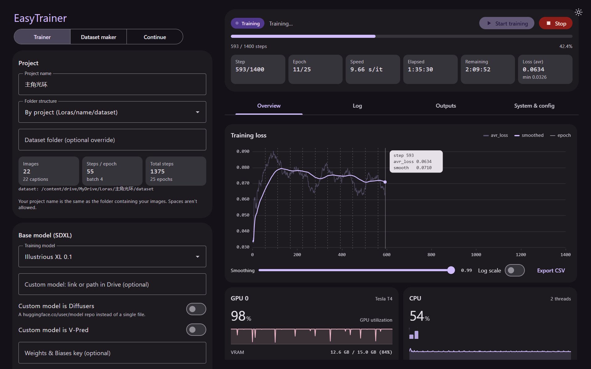
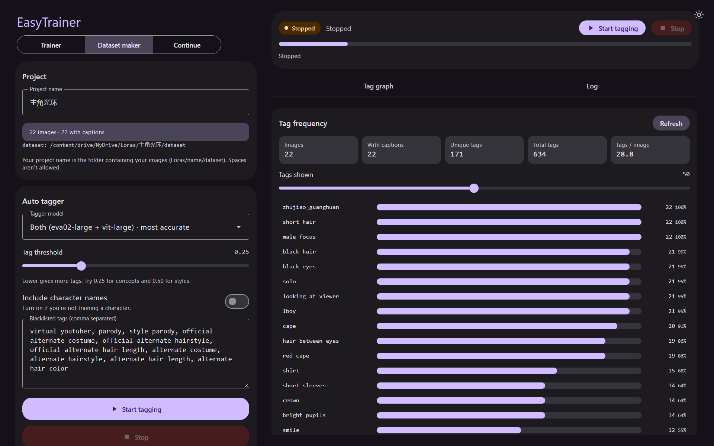
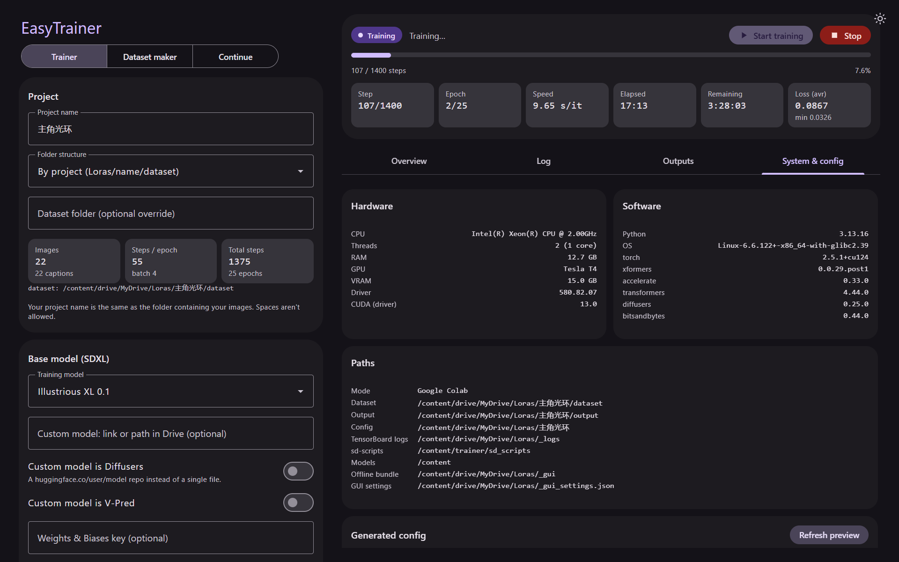

# EasyTrainer

[](https://colab.research.google.com/github/AlamandaCathartica/EasyTrainer/blob/main/GUI_Trainer.ipynb)

A simple web interface for training **Stable Diffusion XL LoRA and LoCon** models. It runs in Google Colab (the free T4 works) or on your own machine, and it keeps your whole workflow in one page: prepare a dataset, train, watch the training live, and continue training later.



## What it does

**Train**
- Every trainer option is a form, with a live check of your dataset: number of images, steps per epoch and total steps.
- Ready-made base models (Illustrious, Pony, Animagine, NoobAI and plain SDXL), or your own model from Drive, Hugging Face or Civitai.
- LoRA and LoCon, several optimizers, and sensible values set for you behind the scenes.
- A preview of the exact config files before anything starts.

**Watch**
- Progress bar with step, epoch, speed and time remaining.
- Interactive loss chart with smoothing, log scale and CSV export.
- GPU, VRAM, CPU, RAM and disk usage while it trains.
- Live log with filters for warnings and errors, plus a list of saved epochs you can download.

**Make a dataset**
- Switch to the **Dataset maker** tab to see how many images have captions and which tags are most common.
- Tag your images automatically with the WD14 taggers (one model or two together), with your own threshold and blacklist.
- Add an activation tag to every caption in one click.



**Continue**
- Switch to the **Continue** tab to train an existing LoRA further.
- Pick a saved `.safetensors`; its rank and type are read from the file so they always match.
- New checkpoints get a new name, so your earlier files are never overwritten.

## How to use it

1. Open the Colab link at the top and choose a **GPU** runtime.
2. Run the cell and open the private link it prints.
3. Put your images in `Loras/<project name>/dataset` on your Google Drive. Your LoRAs are saved in `Loras/<project name>/output`.
4. Tag the dataset, then press **Start training**.

You do not need to upload any files. The code is downloaded automatically each time you run the cell, and the link is protected by a private token.



## Run it locally

```
python gui/kohya_gui.py
```

Then open `http://127.0.0.1:7860`. The GUI itself needs no extra packages. To look around without a GPU, run `python gui/kohya_gui.py --demo`, which simulates a training run.

## Credits and license

Built on kohya-ss's sd-scripts, and based on the kohya-colab notebooks by Hollowstrawberry and Linaqruf's kohya-trainer. Released under the GNU General Public License v3.0.
